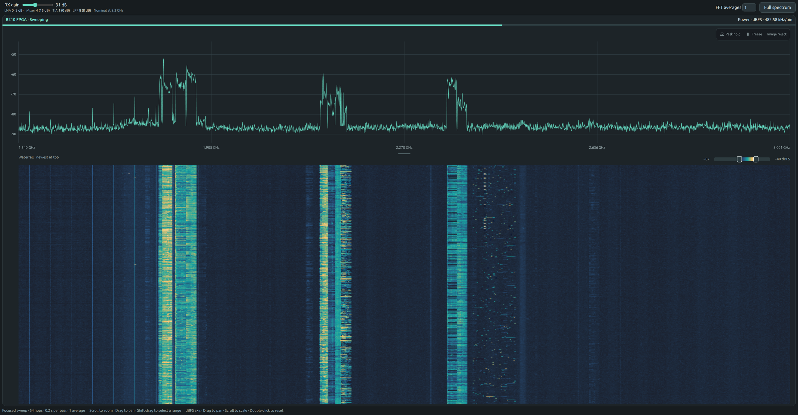

# USRP B210 spectrum analyser

A receive-only web dashboard for the **Kintex-7 B210 clone** identified by UHD as `Custom_SDR_B210` (`type=b200,product=B210`). It sweeps 70 MHz–6 GHz and switches to continuous capture when the zoom fits within 56 MHz.



Before loading the bundled FPGA image, verify that your board matches the `xc7k325tffg676-2` FPGA and pinout in the [clone schematic](docs/hardware-schematic/USRP_B210.pdf).

## Run the dashboard

Build the React frontend from the repository root. Use Node.js 24.x or Node.js 22.13+ from the 22.x line, with npm.

```sh
npm ci
npm run build
```

Install Python 3 and NumPy on the receiver computer. To try the dashboard with **simulated RF data**, run:

```sh
python3 src/spectrum/server.py --demo
```

For the live dashboard, install UHD with its Python bindings on the computer connected to the radio, then run:

```sh
python3 src/spectrum/server.py --antenna TX/RX --fpga-band-sweep
```

Open the [local dashboard](http://127.0.0.1:8000). The live command selects channel 0's TX/RX input and loads the bundled FPGA image into RAM. Use `--antenna RX2` for the other input. Omit `--fpga-band-sweep` for ordinary UHD operation.

Vite builds into `build/spectrum/`. The Python process serves that directory's dashboard at `/`, its bundles at `/assets/`, and the receiver API at `/api/` on the same loopback port. Build in the checkout or copy the entire `build/spectrum/` directory to the same location in the target checkout. Node is only needed where you build or develop the frontend. The dashboard assumes the URL base is `/` and has one page, with no route fallback needed.

Vivado is needed only to rebuild the image. To install a system-wide copy, run `sudo make firmware-install-retune` and pass its path explicitly with `--fpga-band-sweep /usr/local/share/uhd/images/usrp_b210_retune.bin`. The target checks the bundled SHA-256 and installs alongside UHD's normal image. Stop the dashboard before opening the radio in another application. [Firmware build and validation](docs/firmware-build.md)

## Inspect a signal

- Scroll over the spectrum or waterfall to zoom around the pointer. Drag to pan, or hold **Shift** while dragging to select a range. **Full spectrum** returns to 70 MHz–6 GHz.
- With keyboard focus on either chart, use **+** or **−** to zoom, **←** or **→** to pan, and **Home** for the full spectrum. On the power axis, use **+** or **−** to scale, **↑** or **↓** to pan, and **Home** to reset.
- On the left dBFS axis, drag to pan vertically, scroll to scale around the pointer, or double-click to reset to −120 through 0 dBFS.
- Drag the divider to resize both panels, or focus it and use **↑**, **↓**, **Home**, or **End**. A taller waterfall shows more history at one device pixel per row.
- With the default live settings, a span of 56 MHz or less uses continuous capture. Narrow views avoid DC and filter roll-off where possible. The full-width view includes both regions, where power readings can be less reliable.
- Hover to read frequency, power in dBFS, and the displayed bin width. The plot toolbox contains **Peak hold** and **Freeze trace**. Freezing pauses the display while the receiver keeps collecting samples. Use **Peak hold** to show or hide the amber trace, which retains recent peaks for roughly 200–400 ms. The waterfall shows frequency horizontally and recent sweeps vertically, with the newest row at the top.
- Drag either handle on the waterfall color scale to adjust its lower or upper dBFS limit. The colors update across the visible history.
- **Image reject** displays the lowest reading at each frequency across three sweeps. It uses the normal plan and two plans shifted by up to +5 and −5 MHz. Choose **Raw A**, **Raw B**, or **Raw C** to inspect unmodified data, including bursts seen in only one sweep. Images that land at the same frequency in all three sweeps can remain visible.
- The sweep uses 56 MS/s, 56 MHz analog bandwidth, and a 16,384-point FFT by default. FFT spacing is 3.42 kHz. The stitched sweep's finest display bins are 3.77 kHz. Continuous views at 2 MHz or narrower decimate to 14 MS/s and use a 32,768-point FFT (427 Hz spacing). At 500 kHz or narrower, a 65,536-point FFT gives 214 Hz spacing. The master clock and analog bandwidth stay at 56 MHz.
- **FFT averages** sets the number of FFT blocks averaged per capture, from 1 to 32. The default is 8. Higher counts smooth the noise floor and take longer to capture. Use `--averages N` to set the starting value.

## Receiver options

- The default paired plan uses 208 hops at 56 MS/s. Use `--hop-plan uniform` to select the 311-hop plan. [Measured performance](docs/firmware-build.md#measured-performance)
- `--gain DB` sets the starting RX gain (default 35 dB). Use the **RX gain** slider to adjust it while receiving. In unified mode, the readout shows the selected row’s analog stage indices and nominal gains at 2.3 GHz as you move the slider. With the ordinary UHD sweep, try `--rate 40` or `--rate 20` if USB reception is unstable. FPGA sweeping and continuous capture require the default `--rate 56` setting.
- `--gain-table stock` uses UHD’s band-specific tables and is the default. `--gain-table unified` uses UHD’s existing 1.3–4 GHz table across the sweep. It requires the [FPGA sweep image](#unified-gain-table) and works with stock UHD.
- `--device ARGS` overrides the UHD device arguments. The default receive queue uses `num_recv_frames=128`. To use a deeper queue, pass `--device type=b200,product=B210,num_recv_frames=512`.

## Unified gain table

Use stock UHD with the bundled sweep image.

```sh
python3 src/spectrum/server.py --antenna TX/RX --fpga-band-sweep --gain-table unified
```

The FPGA supplies the 1.3–4 GHz AD9361 table whenever UHD loads a gain table. UHD still selects the RF input and gain index and runs calibration. Omit `--gain-table unified` to use stock tables.

## Develop and test the frontend

Start the Python demo or live receiver in one terminal, then run `npm run dev` in another and open the URL Vite prints. Vite proxies `/api/` to `http://127.0.0.1:8000`. If you start Python with another `--port`, set `SPECTRUM_API_URL=http://127.0.0.1:<port>` in the Vite process environment. The API is available for development before the first frontend build.

| Command | Purpose |
| --- | --- |
| `npm ci` | Install the locked frontend dependencies. |
| `npm run dev` | Develop with React Fast Refresh and the receiver API proxy. |
| `npm run build` | Build the assets served by Python. |
| `npm run preview` | Preview the build through Vite with the same API proxy. |
| `npm run lint` | Check JavaScript, JSX and React hook dependencies. |
| `npm test` | Test range logic, binary trace decoding and trace selection. |
| `npx playwright install chromium` | Install Chromium for the browser tests. |
| `npm run test:browser` | Test a fresh production build after running `npm run build`. The suite starts its own Python demo on port 18742. |

Set `SPECTRUM_BROWSER_PATH` when running the browser tests to use a compatible local Chromium executable.

### Follow the data

- [main.jsx](src/spectrum/frontend/src/main.jsx) mounts React and offers a reload if rendering fails. [Dashboard.jsx](src/spectrum/frontend/src/Dashboard.jsx) assembles the page, owns the visible frequency range, and connects the controls to the receiver.
- [useSweep.js](src/spectrum/frontend/src/useSweep.js) polls for sweep metadata and reads the matching binary payload through [receiverApi.js](src/spectrum/frontend/src/receiverApi.js). [spectrumData.js](src/spectrum/frontend/src/spectrumData.js) decodes detail bins and picks the display resolution. The hook tracks the latest capture separately from the displayed frame so freeze can hold the display while capture continues.
- [SpectrumPanel.jsx](src/spectrum/frontend/src/SpectrumPanel.jsx) owns the trace source and peak toggle. Its chart components handle pointer and keyboard input, then draw to canvas. The waterfall keeps its color range in React and its per-row power history in [waterfallCanvas.js](src/spectrum/frontend/src/waterfallCanvas.js).
- Add a capture tool in [SpectrumPanel.jsx](src/spectrum/frontend/src/SpectrumPanel.jsx) or a receiver setting in [ReceiverControls.jsx](src/spectrum/frontend/src/ReceiverControls.jsx), where gain and averaging drafts are kept. Edit [dashboard.css](src/spectrum/frontend/src/dashboard.css) for layout and controls, or the chart renderers for colors and axes inside canvas. Make API changes in [receiverApi.js](src/spectrum/frontend/src/receiverApi.js) and the corresponding handlers in [server.py](src/spectrum/server.py).

For example, scrolling in the waterfall updates the visible band immediately. [useFocusRequest.js](src/spectrum/frontend/src/useFocusRequest.js) waits for the wheel gesture to settle and posts the new band. When polling receives a matching capture, React updates the trace and the waterfall adds a row. On reload, the initial range comes from the Python receiver's current focus. The dashboard uses no browser storage.

### Migration checks

| Feature | Verification |
| --- | --- |
| Root URL, query string, refresh, static assets and API proxy | Python production server, Vite development and Vite preview. |
| Spectrum zoom, pan, selection, hover, reset and freeze | Browser tests with the Python demo. |
| Panel resize, waterfall color scale, keyboard controls, desktop and phone layouts | Browser tests and comparison with the original demo. |
| Gain, unified stage readout, FFT average validation and retry | Live B210 gain and FFT-average changes, plus browser fixtures for validation and failure recovery. |
| Peak hold, image rejection, Raw A/B/C and continuous capture | Live B210 image-set capture, band selection, continuous capture and freeze, plus fixtures and binary decoding tests. |
| Empty sweep, connection recovery and overlapping or failed focus commands | Browser tests with receiver fixtures. |

The dashboard now keeps invalid or failed FFT edits available for correction, reports connection and command errors, and supports keyboard operation on both chart axes. The demo uses simulated data and hides hardware-only controls. Hardware verification used the connected B210 with its configured FPGA image and unified gain table, then restored the original gain, averages, focus and image-rejection settings. Live verification covered that receiver profile.
